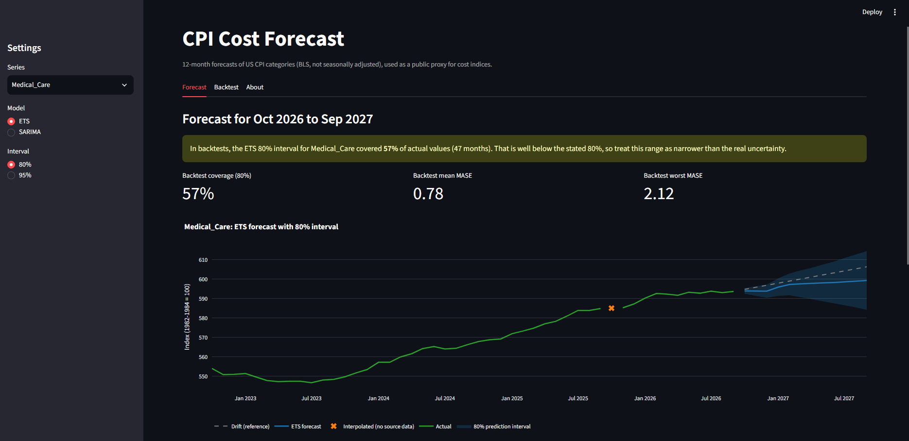
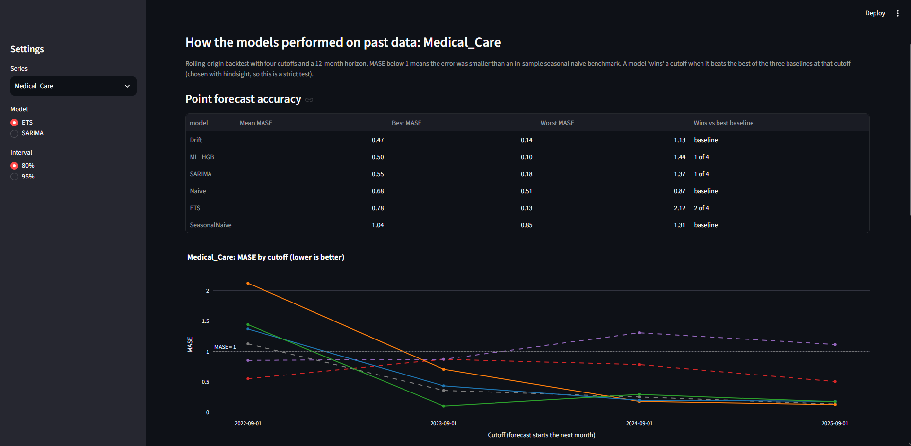

# CPI Cost Forecasting: Simple Baselines vs Statistical and ML Models

A 12-month forecasting project on five US Consumer Price Index (CPI) categories, used as a public proxy for monthly cost indices. It compares simple baselines, ETS, SARIMA and a gradient boosting model with a rolling-origin backtest, measures how well prediction intervals cover actual values, and serves the forecasts in a Streamlit dashboard that shows how far each range can be trusted.

**Driving question:** if a finance team needs a 12-month forecast of monthly cost indices, can statistical or machine learning models beat simple baselines reliably, and how much should the forecast ranges be trusted?



<!-- TODO: add links when available -->

- Live dashboard: https://cpi-cost-forecasting.streamlit.app
- Repository: https://github.com/Yutakuro9029/cpi-cost-forecasting

## Key Findings

1. **Simple baselines are hard to beat.** Drift (last value plus the average historical monthly change) has the lowest mean MASE of all six models on Food (0.217) and Medical_Care (0.468). No statistical or ML model beats the best baseline at every cutoff, except ML_HGB on All_Items (4 of 4), whose specification was changed after the first run (see Limitations).
2. **The best model depends on the series, and the margins are small.** Lowest mean MASE: ML_HGB on All_Items (0.255, SARIMA 0.264), SARIMA on Apparel (0.832, ETS 0.869), ETS on Energy (0.677, Naive 0.742).
3. **Average error hides instability.** On Medical_Care, ETS wins 2 of 4 cutoffs but reaches MASE 2.12 at the 2022-09 cutoff. At that cutoff every trend-following model (ETS, SARIMA, ML_HGB, Drift) has MASE above 1, while the flat Naive forecast does best, because the index stopped rising in the following year.
4. **Prediction intervals look reasonable overall but not per series.** Pooled 80% coverage is 74.5% (ETS) and 77.4% (SARIMA), close to what the same code gives on synthetic data where the models are correct. Per series it ranges from 57% (Medical_Care, both models) to 94% (All_Items, ETS).
5. **An interval should be shown with its measured coverage.** The dashboard labels each range with its backtest coverage and warns when it is far below the stated level, so a narrow range is not over-trusted.

## Approach

### Data

CPI for All Urban Consumers (CPI-U), U.S. city average, monthly, not seasonally adjusted, January 2010 to September 2026, from the BLS Public Data API. October 2025 has no value in the source data for any series. It is kept as a missing value in all analysis and backtests (see [Handling the missing month](#handling-the-missing-month)).

| Column       | BLS series ID | Category     |
| ------------ | ------------- | ------------ |
| All_Items    | CUUR0000SA0   | All items    |
| Food         | CUUR0000SAF1  | Food         |
| Energy       | CUUR0000SA0E  | Energy       |
| Apparel      | CUUR0000SAA   | Apparel      |
| Medical_Care | CUUR0000SAM   | Medical care |

### Backtest

- **Rolling origin:** four cutoffs (2022-09, 2023-09, 2024-09, 2025-09). Each model is trained only on data up to the cutoff and forecasts the next 12 months.
- **Metrics:** MAE, and MASE scaled by the in-sample seasonal naive MAE of the training data. MASE below 1 means the error is smaller than that benchmark.
- **Missing values:** months without an actual value are skipped, so the last cutoff has 11 evaluated months (47 per series and model).
- **Strict comparison:** a model "wins" a cutoff when it beats the best of the three baselines at that cutoff. The best baseline is chosen with hindsight.

### Models

| Model                            | Description                                                                                                                                                                                        |
| -------------------------------- | -------------------------------------------------------------------------------------------------------------------------------------------------------------------------------------------------- |
| Naive                            | Repeats the last observed value                                                                                                                                                                    |
| Seasonal Naive                   | Same month one year earlier                                                                                                                                                                        |
| Drift                            | Last value plus the average monthly change over the training period                                                                                                                                |
| ETS(A,A,A)                       | Exponential smoothing with additive error, trend and 12-month seasonality (`statsmodels`)                                                                                                          |
| SARIMA (0,1,1)(0,1,1,12) + drift | The "airline" specification (`statsmodels`)                                                                                                                                                        |
| ML_HGB                           | `HistGradientBoostingRegressor` predicting month-over-month changes from lags 1, 2, 3, 12, a 3-month rolling mean and the month number; recursive multi-step forecast added back to the last level |

ETS and SARIMA specifications were fixed in advance. All 20 ETS and 20 SARIMA fits in the backtest converged (checked with the optimizer flag and `ConvergenceWarning`).

## Results

### Mean MASE across four cutoffs (lower is better)

| Series       | Naive | Seasonal Naive | Drift     | ETS       | SARIMA    | ML_HGB    |
| ------------ | ----- | -------------- | --------- | --------- | --------- | --------- |
| All_Items    | 0.783 | 1.647          | 0.320     | 0.289     | 0.264     | **0.255** |
| Apparel      | 1.148 | 0.960          | 1.196     | 0.869     | **0.832** | 0.932     |
| Energy       | 0.742 | 0.867          | 0.787     | **0.677** | 0.779     | 0.964     |
| Food         | 0.722 | 1.682          | **0.217** | 0.392     | 0.402     | 0.642     |
| Medical_Care | 0.678 | 1.037          | **0.468** | 0.785     | 0.547     | 0.504     |

### Wins against the best baseline (out of 4 cutoffs)

| Series       | ETS | SARIMA | ML_HGB |
| ------------ | --- | ------ | ------ |
| All_Items    | 1   | 2      | 4      |
| Apparel      | 1   | 2      | 1      |
| Energy       | 2   | 2      | 0      |
| Food         | 2   | 1      | 0      |
| Medical_Care | 2   | 1      | 1      |

### Prediction interval coverage

Pooled over 235 evaluated months per model (5 series x 47 months):

| Model  | 80% interval | 95% interval |
| ------ | ------------ | ------------ |
| ETS    | 74.5%        | 84.7%        |
| SARIMA | 77.4%        | 91.1%        |

Reference from a calibration test on 100 synthetic series where both models are appropriate (`tests/test_calibration.py`): ETS 73.9% / 90.8%, SARIMA 75.9% / 91.4%. Coverage slightly below the stated level is therefore expected from this interval method, which does not include parameter estimation uncertainty.

80% coverage by series:

| Series       | ETS   | SARIMA |
| ------------ | ----- | ------ |
| All_Items    | 93.6% | 91.5%  |
| Apparel      | 68.1% | 93.6%  |
| Energy       | 78.7% | 85.1%  |
| Food         | 74.5% | 59.6%  |
| Medical_Care | 57.4% | 57.4%  |

Each series has only 47 test months, and months within one forecast are correlated, so differences of a few percentage points are not meaningful.

## Dashboard

The Streamlit app forecasts October 2026 to September 2027 from all available data.

- **Forecast:** forecast with an 80% or 95% interval, a Drift reference line, the backtest coverage of the selected interval (with a warning when it is more than 10 percentage points below the stated level), and a CSV download.
- **Backtest:** MASE by model and cutoff, interval coverage by model and level, and a view that re-runs one backtest to show the direction of the error.
- **About:** data source, methods and limitations.



## Handling the missing month

October 2025 has no value in the source data for any of the five series.

**Analysis and backtests:** the month stays missing. The data keeps one row per calendar month, so a 12-month lag always points to the same month one year earlier, and the missing month is excluded from every error and coverage calculation (the 2025-09 cutoff is scored on 11 months instead of 12). No backtest training window includes the gap, so backtest results do not depend on how it is handled.

**Live forecast:** ETS and SARIMA need a complete training series, so three options were considered:

| Option                                             | Benefit                                                       | Cost                                                     |
| -------------------------------------------------- | ------------------------------------------------------------- | -------------------------------------------------------- |
| Show backtests only                                | Every number shown has been tested                            | No forward forecast, which is what a finance user needs  |
| Fill October 2025 and forecast from September 2026 | Uses all available data and gives a 12-month forward forecast | One month is an estimate, not source data                |
| Forecast from data up to September 2025            | No filled values                                              | Drops the latest 11 months and forecasts 23 months ahead |

The second option was chosen. One estimated month out of 201 has a small effect on the fitted models, while dropping the latest 11 months would remove the most relevant data and nearly double the forecast horizon, which makes the intervals much wider and less useful.

The month is filled by linear interpolation between September and November 2025 (`fill_single_month_gaps` in `data_utils.py`). The function only fills isolated one-month gaps and raises an error for longer gaps or gaps at the start or end of the data, so a future data problem cannot be filled silently. The filled month is marked on the dashboard chart. Linear interpolation ignores seasonality, so the filled value may be slightly off for series with a strong October effect, such as Apparel and Energy.

## How to run

Python 3.12.3

```bash
# Create and activate a virtual environment
python -m venv .venv
.venv\Scripts\activate          # Windows
# source .venv/bin/activate     # macOS / Linux

python -m pip install -r requirements-dev.txt
```

The data is included in `data/cpi_data.csv`. To download it again, register for a free key at the [BLS registration page](https://data.bls.gov/registrationEngine/) and add it to a `.env` file in the project root:

```
BLS_API_KEY=your_key_here
```

Then delete `data/cpi_data.csv` and run the first cell of the notebook.

Run from the project root:

```bash
jupyter notebook cpi_analysis.ipynb   # full analysis
python -m pytest -m "not slow"        # unit tests, a few seconds
python -m pytest -m slow              # interval calibration test, about 1 minute
streamlit run app.py                  # dashboard
```

## Project structure

```
.
├── app.py                 Streamlit dashboard
├── cpi_analysis.ipynb     Analysis notebook (EDA, backtests, results)
├── data_utils.py          BLS download, loading, missing-month handling
├── models.py              Baselines, ETS, SARIMA, ML model, prediction intervals
├── metrics.py             MAE, MASE, interval coverage
├── backtest.py            Rolling-origin backtest
├── tests/                 Unit tests on synthetic data (pytest)
├── pytest.ini             Test configuration
├── requirements.txt       Runtime dependencies
├── requirements-dev.txt   Runtime dependencies plus pytest
├── README.md
├── data/                  CPI data and retrieval metadata
├── results/               Backtest results (CSV)
├── plots/                 Figures from the notebook
└── docs/                  Screenshots for this README
```

## Limitations

- **Few cutoffs:** four cutoffs per series. Small differences in mean MASE cannot be separated from luck, and no significance test was run.
- **Correlated test months:** errors within one 12-month forecast are correlated and training windows overlap, so the effective sample size is smaller than 47 months per series.
- **Proxy data:** CPI categories are public price indices, not a specific company's costs.
- **ML specification changed after seeing results:** the first run (`max_iter=50, max_depth=3`, default `min_samples_leaf`) could not learn a simple seasonal pattern in a synthetic unit test, so it was changed to `max_iter=200, max_depth=4, min_samples_leaf=5`. The change was based on synthetic data but made after the first backtest. First-run mean MASE: All_Items 0.334, Apparel 0.819, Energy 0.710, Food 0.515, Medical_Care 0.549.
- **Hindsight benchmark:** the best baseline is chosen per cutoff after the fact, which makes win counts stricter than a real comparison.
- **Univariate models:** no external drivers (for example oil prices for Energy), so sudden shocks cannot be anticipated.
- **Interval method:** intervals assume the fitted model is correct and ignore parameter uncertainty.
- **Interpolated month:** the October 2025 fill used for the live forecast ignores seasonality, which matters most for Apparel and Energy.

## Dataset Credit

**Source:** U.S. Bureau of Labor Statistics, Consumer Price Index for All Urban Consumers (CPI-U), U.S. city average, not seasonally adjusted. Series CUUR0000SA0, CUUR0000SAF1, CUUR0000SA0E, CUUR0000SAA and CUUR0000SAM, retrieved through the BLS Public Data API on 2026-11-07.

**License:** the BLS [copyright information page](https://www.bls.gov/opub/copyright-information.htm) states that "everything that we publish, both in hard copy and electronically, is in the public domain" (except previously copyrighted photographs and illustrations), and asks that the Bureau of Labor Statistics be cited as the source.

**Disclaimer (required by the [BLS API terms of service](https://www.bls.gov/developers/termsOfService.htm)):** BLS.gov cannot vouch for the data or analyses derived from these data after the data have been retrieved from BLS.gov.

The data was first retrieved from FRED and then replaced with the same series downloaded directly from BLS. The two datasets were identical for all 201 months, including the missing October 2025, so no results changed.
